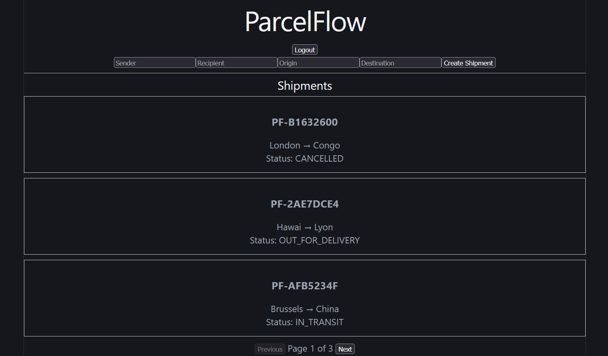
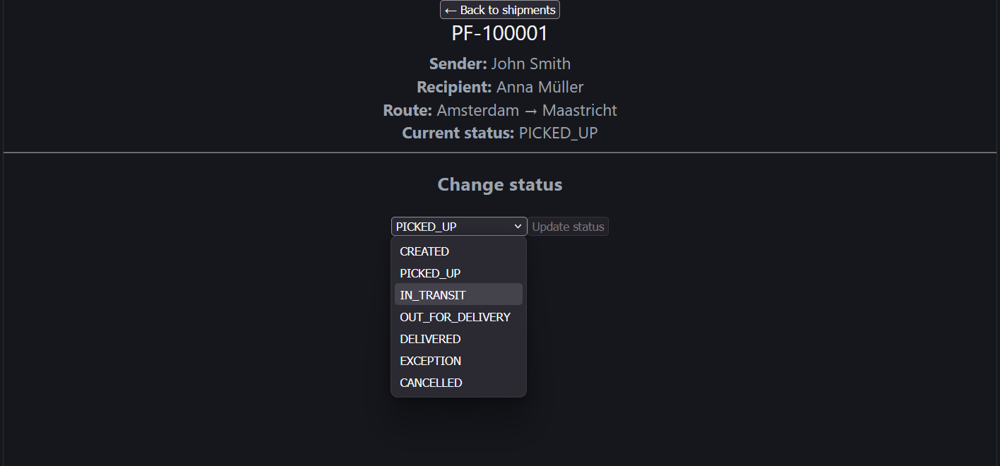
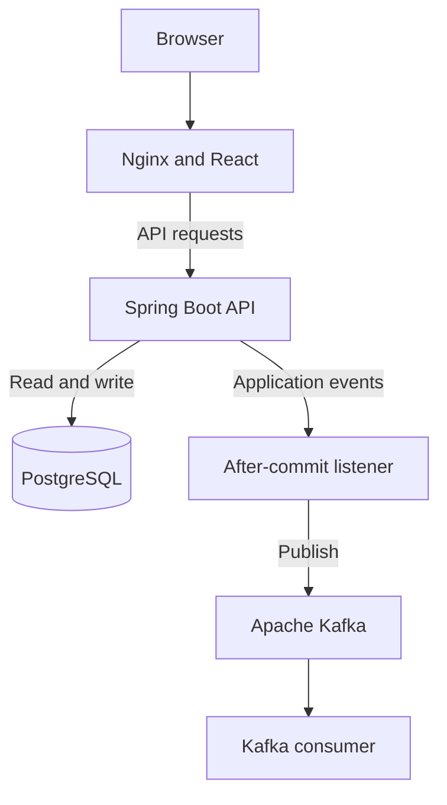

# ParcelFlow

**A full-stack logistics and shipment tracking application built with Spring Boot, React, PostgreSQL, Apache Kafka, and Docker.**

[](https://github.com/sarpery/parcelflow/actions/workflows/ci.yml)

ParcelFlow allows users to create and track shipments, while administrators can manage shipment status transitions.

The project demonstrates REST API development, JWT authentication, asynchronous event processing, containerization, automated testing, and CI/CD.


## Features

- User registration and login using JWT authentication
- BCrypt password hashing
- USER and ADMIN role-based authorization
- Shipment creation and tracking
- Shipment status lifecycle validation
- Pagination and status-based API queries
- REST API validation and structured error responses
- Asynchronous shipment status events using Apache Kafka
- React and TypeScript frontend
- Docker Compose orchestration with health checks
- Automated testing with JUnit, Mockito, MockMvc, and Testcontainers
- GitHub Actions CI and Docker image publishing to GHCR


## Screenshots

### Shipment Dashboard



### Shipment Details


## Tech Stack

| Layer | Technologies |
|---|---|
| Backend | Java 21, Spring Boot 4, Spring Data JPA |
| Security | Spring Security, JWT, BCrypt |
| Frontend | React, TypeScript, Vite |
| Database | PostgreSQL 18 |
| Messaging | Apache Kafka |
| Containers | Docker, Docker Compose, Nginx |
| Testing | JUnit, Mockito, MockMvc, Testcontainers |
| CI/CD | GitHub Actions, GitHub Container Registry |

## Architecture



Nginx serves the React frontend and forwards `/api/` requests to Spring Boot.

Spring Boot handles authentication, authorization, shipment management, and event publishing.

PostgreSQL stores persistent application data.

Kafka handles asynchronous shipment status events.

## Shipment Lifecycle

```text
CREATED
  |-- PICKED_UP
  |      |
  |      v
  |   IN_TRANSIT
  |      |
  |      v
  |   OUT_FOR_DELIVERY
  |      |
  |      v
  |   DELIVERED
  |
  +-- CANCELLED
```

Shipments can also enter `EXCEPTION` from `IN_TRANSIT` or `OUT_FOR_DELIVERY`, then return to `IN_TRANSIT`.

`DELIVERED` and `CANCELLED` are terminal states.

## Getting Started

### Prerequisites

- Git
- Docker Desktop
- Docker Compose

### 1. Clone the repository

```bash
git clone https://github.com/sarpery/parcelflow.git
cd parcelflow
```

### 2. Configure environment variables

Create a `.env` file in the repository root:

```dotenv
POSTGRES_DB=parcelflow
POSTGRES_USER=parcelflow
POSTGRES_PASSWORD=REPLACE_WITH_YOUR_LOCAL_PASSWORD
JWT_SECRET=REPLACE_WITH_A_BASE64_ENCODED_32_BYTE_SECRET
```

Replace the placeholders before starting.

Never commit real credentials to Git.

### 3. Create persistent volumes

```bash
docker volume create parcelflow_postgres_data
docker volume create parcelflow_kafka_data
```

### 4. Start the application

```bash
docker compose -f compose.yaml up -d --build
```

### 5. Check container health

```bash
docker compose -f compose.yaml ps
```

### 6. Open ParcelFlow

Frontend: http://localhost:5173

Backend health endpoint: http://localhost:8080/actuator/health

### 7. Stop the application

```bash
docker compose -f compose.yaml down
```

External database and Kafka volumes remain intact.

## API Overview

| Method | Endpoint | Description |
|---|---|---|
| POST | `/api/auth/register` | Register a USER account |
| POST | `/api/auth/login` | Authenticate and receive a JWT |
| GET | `/api/shipments` | Retrieve paginated shipments |
| GET | `/api/shipments/{id}` | Retrieve a shipment |
| POST | `/api/shipments` | Create a shipment |
| PATCH | `/api/shipments/{id}/status` | Update status (ADMIN) |
| GET | `/api/shipments/status/{status}` | Find shipments by status |

Shipment endpoints require authentication. The status-update endpoint additionally requires the ADMIN role.

## Automated Testing

ParcelFlow contains tests for:

- Shipment event data
- Shipment service and status transitions
- Controller HTTP responses and validation
- PostgreSQL repository integration
- Authentication and role-based authorization

Run the full backend test suite:

```bash
mvn clean verify
```

Docker must be running for the Testcontainers integration tests.

## CI/CD

GitHub Actions validates backend tests and the React build before building Docker images.

Successful pushes to `master` publish backend and frontend images to GitHub Container Registry.

Images:

- `ghcr.io/sarpery/parcelflow-backend`
- `ghcr.io/sarpery/parcelflow-frontend`

Both `latest` and Git commit SHA tags are published.

A separate `compose.ghcr.yaml` file supports local deployment using prebuilt images.

## Deployment

Detailed setup, configuration, architecture, and troubleshooting instructions are available in the [Deployment Guide](docs/deployment.md).

The current deployment is a local production-style simulation. Public cloud hosting and HTTPS are not configured.

## Future Improvements

- Implement a transactional outbox for reliable Kafka publishing
- Add idempotent event processing
- Improve monitoring and observability
- Introduce database migration tooling
- Expand automated security and integration tests
- Deploy behind HTTPS to a public hosting environment
